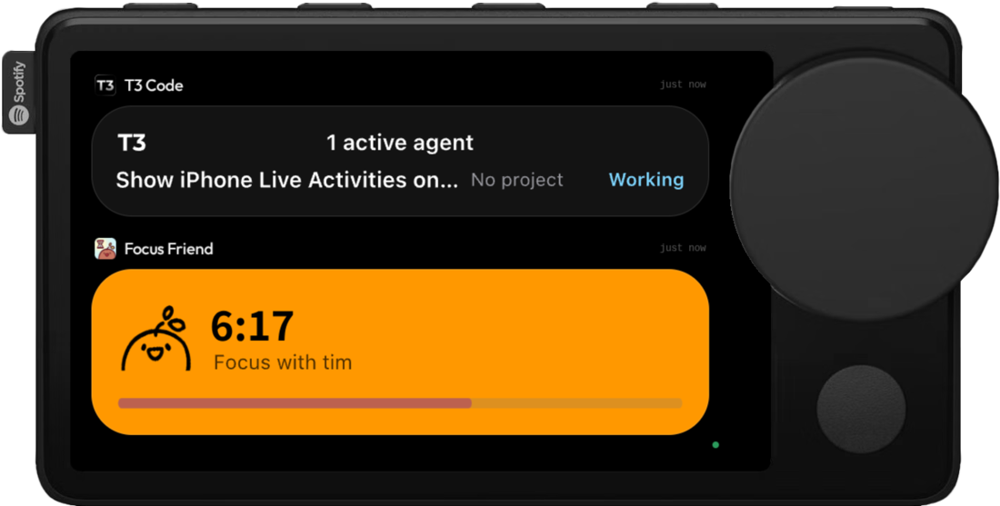
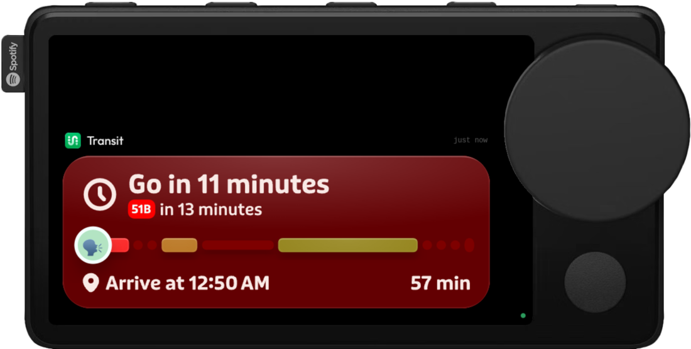
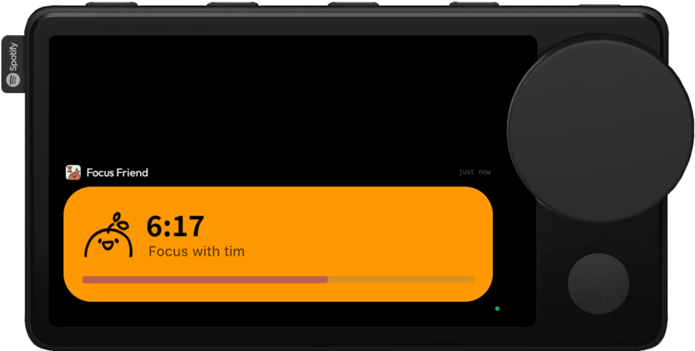

# Live Activities for the Car Thing

Shows your iPhone's Live Activities on a Spotify Car Thing running [bridgething](https://bridgething.com), full screen
and redrawn natively: timers tick, progress bars move, and changed digits roll the way they do on iOS.

Each activity is rendered on the Car Thing itself, from the same data your Mac uses. macOS 26 mirrors your iPhone's
Live Activities into the menu bar, and the iPhone does the layout: it runs each app's widget code and sends the Mac a
finished SwiftUI view, serialized as a display list of shapes, glyph runs, images, embedded font subsets, and the timers
and progress bars iOS keeps ticking. Control Center just plays that archive back. This app reads the same archives from
the system's own store, decodes Apple's undocumented format, and hands them to the Car Thing, which draws them as vector
graphics at its own resolution, with the live parts still live.



<p>
  
  
</p>

## Requirements

- **The Car Thing plugged into your Mac over USB.** The cable it came with works, as does the one you flashed
  bridgething with. The Car Thing has no Wi-Fi, so the Mac reaches it only over that cable: this is a desk setup, and
  it shows nothing while it runs off a car charger.
- A Mac on macOS 26 or later, signed in to the same Apple Account as your iPhone, with iPhone Live Activities showing in
  the menu bar (System Settings > Control Center > Live Activities).
- The bridgething desktop app on that Mac, with the Car Thing connected to it.
- **Full Disk Access for the bridgething desktop app** (System Settings > Privacy & Security > Full Disk Access). macOS
  keeps Live Activity data in protected system containers, and the app's extension runs inside the desktop app, so the
  permission has to be granted to the desktop app itself.

Install **Live Activities** from the bridgething store in the desktop app. When an activity starts on your iPhone, the
Car Thing switches to it; when the last one ends, it goes back to what it was showing. Turn that off with the app's
**Open automatically** setting.

## What the extension can access

The store lists these permissions before you install:

| Permission | Why |
| --- | --- |
| `read:~/Library/Group Containers/group.com.apple.liveactivitiesd` | activity list and each app's content state |
| `read:~/Library/Group Containers/group.com.apple.chronod/chronod/remoteArchives` | the views your iPhone rendered for each activity |
| `read:/System/Library/Fonts`, `read:/Library/Fonts` | system glyphs an archive references but does not embed |
| `net` | App Store icon lookup, and reaching the Car Thing over USB to bring the app forward |
| `read:~/Library/Preferences/com.apple.controlcenter.plist` | checking that iPhone Live Activities are turned on, to explain it if not |
| `sys:homedir`, `sys:networkInterfaces`, `sys:osRelease` | finding your home folder, the Car Thing's USB link, and the macOS version |

It only reads; it never writes to those folders, and nothing leaves your Mac except to your Car Thing and the
App Store icon lookup.

## Troubleshooting

When something in the setup is missing, the Car Thing says what and how to fix it, and the desktop app's log has the
same message. The checks run every 10 seconds, so fixes take effect without reinstalling.

| The Car Thing says | Fix |
| --- | --- |
| Live Activities needs a Mac | Run the bridgething desktop app on a Mac; Windows and Linux never receive iPhone Live Activities. |
| This Mac needs macOS 26 | Update the Mac. iPhone Live Activities on the Mac started with macOS 26 Tahoe. |
| Give bridgething Full Disk Access | System Settings > Privacy & Security > Full Disk Access, turn on bridgething, then reopen it. |
| Live Activities is missing a permission | Reinstall the app in the desktop app and approve its permissions. |
| iPhone Live Activities are off on this Mac | Search System Settings for "Live Activities" and turn on Live Activities from iPhone. |
| No iPhone is connected to this Mac | Sign in to the same Apple Account on both, iPhone on iOS 26, Bluetooth and Wi-Fi on. |
| Waiting for a first Live Activity | Start one on the iPhone; once it shows in the Mac menu bar it shows here. |
| Connect your Mac | The Car Thing hears nothing from a Mac: plug it into the Mac over USB, open the desktop app, and check this app is installed and enabled there. |

## How it works

```text
iPhone liveactivitiesd -> IDS / Replicator -> Mac liveactivitiesd -> liveactivitiesd.sql (descriptor, content state)
                                           -> Mac chronod         -> remoteArchives/**.activity-archive
                                                                     (SwiftUI display lists the iPhone rendered)
extension (Deno, in the bridgething desktop app)
  watches both, decodes each archive into SVG -> forward surface -> webapp on the Car Thing
```

- `apps/live-activities/extension/source.ts` reads the activity store and finds each activity's archive.
- `apps/live-activities/extension/archive/` decodes SwiftUI's archived views: the chunk container and manifest, the
  protobuf display list, RenderBox drawing chunks, embedded fonts, images, and content transitions. The format is
  written up in [`docs/archive-format.md`](docs/archive-format.md).
- `apps/live-activities/extension/main.ts` turns changes into snapshots for the Car Thing and brings the app to the
  front when an activity starts.
- `apps/live-activities/src/` is the webapp: the activities' lock-screen views at the screen's width, with timers,
  progress and numeric text animated on the device.

Lock-screen glass is reproduced from measurements: a tinted card shows the app's tint at full saturation over the Car
Thing's black backdrop, and an untinted card is `#131313`, as an iPhone draws them over a black wallpaper.

## Develop

```sh
bun install
bun run --cwd apps/live-activities dev:device   # webapp on the Car Thing, extension under deno with its declared permissions
bun run check                                   # typecheck, build, and validate the catalog, as CI does
bun run render <archive> --tag listItem --png out.png --bg '#000'   # render any archive to svg or png
```

The terminal you develop from needs Full Disk Access, since the dev loop runs the extension as its child.
`tools/fixtures/` (gitignored) is where local test archives go; copy them from the `remoteArchives` folder above.

## Acknowledgements

The display list field numbers were worked out with help from [OpenSwiftUI](https://github.com/OpenSwiftUIProject/OpenSwiftUI)'s
reimplementation of SwiftUI's protobuf encodings.

The device frame in `docs/images/` comes from the [bridgething](https://github.com/JoeyEamigh/bridgething) website
(MIT, Joey Eamigh).

## License

MIT
